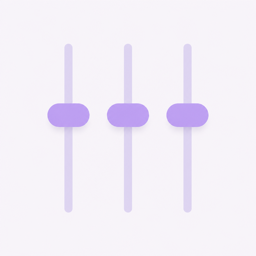
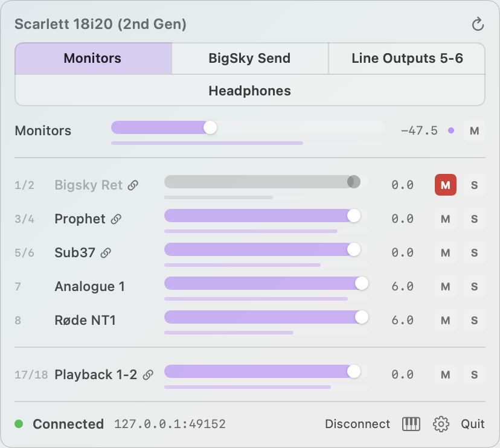

<p align="center">
  
</p>

<h1 align="center">Scarlett MIDI Control</h1>

<p align="center">
  macOS menu-bar mixer for <strong>classic Focusrite Control</strong> — drive a
  <strong>Scarlett 18i20 (2nd Gen)</strong> from MIDI and a compact SwiftUI panel.
</p>

<p align="center">
  
</p>

It does not copy any proprietary Focusrite code. Parameter IDs are discovered at runtime from `<device-arrival>`.

### What it does
- Discovers `FocusriteControlServer` over UDP, connects over TCP, and waits for Remote Devices approval
- Per-output mixer: pick an analogue destination, then mix hardware inputs and software playback with level / mute / solo
- Stereo-linked channels collapse to **one fader**
- MIDI Learn on **each** control: per-output master level/mute, and per-mix strip gain/mute/solo
- Settings (client name, auto-reconnect, visible outputs, MIDI port, mapping list) live in a **gear popover** on the connection row

### Requirements
- macOS 14+
- Classic Focusrite Control installed, with `FocusriteControlServer` running
- Approve **Scarlett MIDI Control** in Focusrite Control → Settings → Remote Devices
- Full Xcode (not just Command Line Tools) if you want to run `swift test` locally — CI has Xcode

### Run locally

```bash
./scripts/run-local.sh
```

That builds with SwiftPM, wraps an ad-hoc `.app`, and relaunches the menu-bar extra. Click the **mixer fader** icon (`slider.vertical.3`) in the menu bar.

Optional XcodeGen project: `xcodegen generate` then open `ScarlettMidiControl.xcodeproj`.

### Opening a downloaded build

CI uploads an ad-hoc-signed zip. Gatekeeper will refuse it with *Apple could not verify “ScarlettMidiControl”* and only **Move to Trash** / **Done**. After unzipping:

```bash
xattr -dr com.apple.quarantine ScarlettMidiControl.app
open ScarlettMidiControl.app
```

Or System Settings → Privacy & Security → **Open Anyway**. Local `./scripts/run-local.sh` builds skip this.

### MIDI Learn
1. Click the piano-keys button on the connection row (it turns ember when armed).
2. Click a fader, mute, or solo.
3. Move a knob (CC) or hit a note on the selected MIDI input.
4. An ember dot marks mapped faders. Clear mappings from the gear popover.

Masters are keyed by output (Monitors uses the hardware monitor pair; Headphones is a different mapping). Mix strips are keyed by the mix assigned to that output (Mix A–E slot index).

### Visible outputs
By default only analogue pairs are shown (ADAT / S/PDIF hidden). Customize from the gear popover. The output switcher is a one-click chip grid, not a dropdown.

---

## Repository

- Origin: `https://origin.cursor.com/catkins/scarlett-midi-remote.git`
- There is **no GitHub remote**. Do not replace the `origin` remote.
- License: MIT

## CI (Buildkite)

Pipeline: [catkins-test/scarlett-midi-remote](https://buildkite.com/catkins-test/scarlett-midi-remote)

- Cluster: hosted macOS (`hosted-macos` queue)
- Steps: lint, Test Engine (`bktec run`), and a release `.app` zip artifact
- Artifact: `tmp/ScarlettMidiControl.app.zip` on the App step
- Test Engine suite: `scarlett-midi-remote` (JUnit at `tmp/swift-test-results.xml`)
- Definition: `.buildkite/pipeline.yml` (commands live in `scripts/ci.sh` so bash `${…}` is not interpolated at pipeline upload)
- Shared SwiftPM cache: per-step volumes (`swift-test` / `swift-app`) so debug tests and the release .app do not share `.build`
- Local helper: `./scripts/ci.sh` (skips SwiftLint if missing; Command Line Tools need extra flags for `import Testing`)

Trigger builds from the Buildkite UI. Clone uses Origin (`https://origin.cursor.com/git/catkins/scarlett-midi-remote.git`).

## Layout

- `FocusriteControlKit` — discovery, TCP client, XML framing, device/mixer model
- `MidiKit` — CoreMIDI input, mapping IDs (`MidiTarget`)
- `PersistenceKit` — UserDefaults + `~/Library/Application Support/ScarlettMidiControl/mappings.json`
- `App/` — menu-bar SwiftUI (mixer chrome, settings popover, snapshot renderer)

Protocol notes: `docs/PROTOCOL.md`

## Visual snapshots

Agents (and you) can render the mixer chrome without clicking the menu bar:

```bash
./scripts/snapshot-ui.sh
# writes .build/snapshots/mixer.png
```

The app also accepts `ScarlettMidiControl --snapshot /path/to/out.png` and exits.
